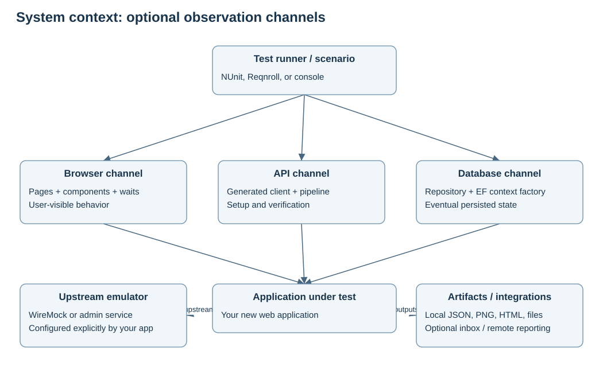

# Architecture: start here

This repository is a test automation platform for a new web application. Tests compose browser, API, database and emulator capabilities around one explicitly owned test scope. Application-specific pages, contracts, workflows and assertions sit above those capabilities. SampleApp and the public date-picker journeys demonstrate the boundaries; they are not your future application's business implementation.

The design is a modular library architecture with ports and adapters at change-prone boundaries. It runs as a test process calling libraries directly. Selenium, HTTP transports, EF providers and reporting clients adapt those libraries to external systems. A dependency-injection container is optional.

## Reading routes

| Your question | Read |
|---|---|
| How does everything fit together? | [High-level design](HIGH-LEVEL-DESIGN.md) |
| Which classes collaborate, in what order? | [Low-level design](LOW-LEVEL-DESIGN.md) |
| Why these choices and compromises? | [Architecture decisions](DECISIONS.md) |
| Where is SOLID actually applied? | [SOLID and engineering](SOLID.md) |
| How do the four calendar suites work? | [Date-picker design and runbook](DATE-PICKERS.md) |
| How do I start my application's tests? | [New-app recipe](NEW-APP-RECIPE.md) and [extension guide](EXTENDING.md) |
| What was adapted from the original? | [Extraction map](EXTRACTION.md) |
| What really ran? | [Validation evidence](VALIDATION.md) |
| Where are editable UML diagrams? | [Diagram catalog](diagrams/README.md) |

Open [the visual handbook](handbook.html) for an offline reading view with rendered diagrams. Markdown and editable Mermaid files are also included.

## Central design rule

**A test owns its resources; adapters own technical mechanics; scenarios own business intent.** For example, TestScope owns browser lifetime, BrowserWait checks readiness, MonthNavigator reaches a month, GlobalSqaPage selects the iframe, and GSQ-01 asserts the leap-day outcome.

UI, API and database channels observe different aspects of an application. Each is optional. A calendar test needs only UI access. An API test may never start a browser. A database assertion requires the application's schema and connection. Libraries do not automatically connect an application to an emulator or database.

## Preserved ideas and deliberate changes

The original framework separated generated API families, page objects, reusable steps, settings and database helpers. This starter retains those ideas, explicit Selenium waits, API generation, HTTP fault emulation, admin settings/benchmarks and integrations. It replaces mutable global registries and cross-test browser reuse with explicit ownership. It replaces business contracts/workflows with neutral examples; the extraction report records the differences.

The calendar addition extends the same architecture. Its NUnit fixture and console runner invoke one scenario catalog using the existing TestScope, BrowserFactory, BrowserSessions, BrowserWait and diagnostics.

## Practical limits

TestScope constructs the default browser factory, token provider and local publisher; it is not fully configurable through constructor interfaces. An alternate composition root can supply different implementations directly. Automation.Testing references NUnit, so the console runner avoids NUnit discovery but still transitively references the package. CalendarPage navigates in its constructor, a pragmatic page-adapter choice with an observable side effect. The documentation describes these compromises rather than claiming perfect architectural purity.
