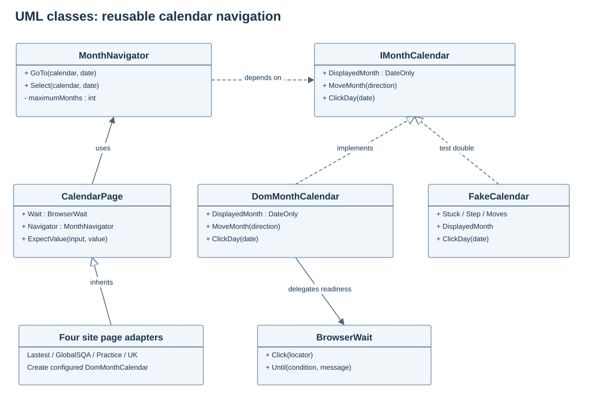
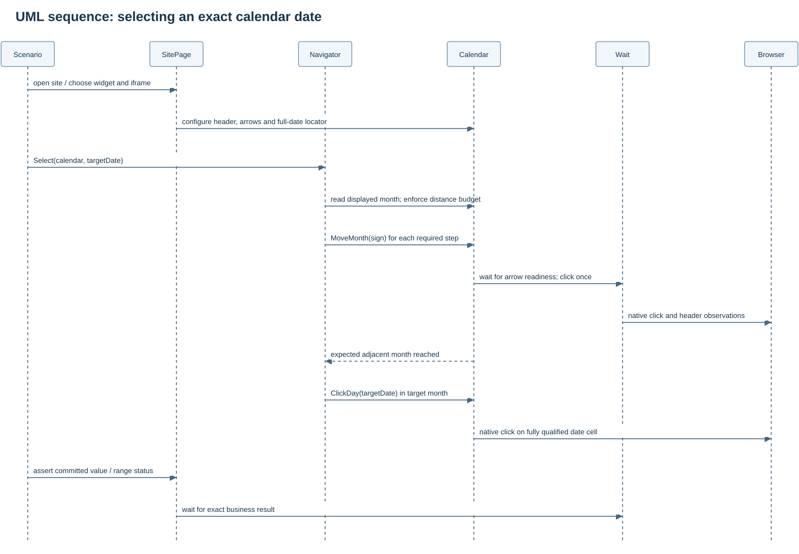
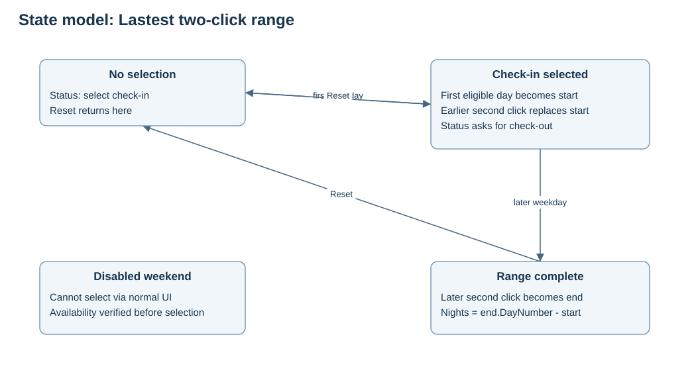

# Date-picker design and runbook

The suite contains 19 complex UI scenarios on the four requested public sites. It is an example of extending this starter with reusable components, not a replacement for testing your application's own calendar rules.

## Run locally

Run from the extracted repository root. The console route executes exactly the same scenario bodies as NUnit and avoids the workstation's earlier test-discovery problem.

```powershell
dotnet restore WebAutomation.sln --locked-mode --configfile NuGet.Config
dotnet build WebAutomation.sln -c Release --no-restore
dotnet run --project tools/DatePickerRunner -c Release --no-build -- --self-test
dotnet run --project tools/DatePickerRunner -c Release --no-build -- --list
dotnet run --project tools/DatePickerRunner -c Release --no-build -- --live
```

The local self-test performs eight checks without a browser or network. Live execution requires an installed browser, driver resolution and access to the four sites. Default browser is headless Chrome.

```powershell
dotnet run --project tools/DatePickerRunner -c Release --no-build -- --live --site globalsqa
dotnet run --project tools/DatePickerRunner -c Release --no-build -- --live --case UK-05 --headful
dotnet run --project tools/DatePickerRunner -c Release --no-build -- --live --output artifacts/my-calendar-run
```

Site names are lastest, globalsqa, practice and uk. Unknown options and zero-match selections fail clearly. --live is required; invoking the runner with no arguments only prints usage. Each case creates its own scope/browser and the runner executes sequentially. Exit code is zero only when all selected cases pass.

For NUnit:

```powershell
$env:AUTOMATION_LIVE_DATEPICKERS = '1'
dotnet test tests/Automation.DatePickers -c Release --filter 'TestCategory=DatePicker' --logger trx
Remove-Item Env:AUTOMATION_LIVE_DATEPICKERS
```

Without that environment flag, the fixture ignores public-site cases intentionally. Filter TestCategory=uk or another site category for a subset. The manual GitHub Actions workflow, public-datepickers.yml, invokes the console runner and uploads its artifacts. It has not been dispatched remotely during preparation.

## Component architecture



- CalendarDates handles civil dates, leap years, ISO/English formatting and month arithmetic.
- IMonthCalendar exposes only the displayed month, one-month movement and day selection.
- MonthNavigator validates distance and progress, independently of Selenium.
- DomMonthCalendar implements the transition contract using the existing BrowserWait.
- CalendarPage holds the browser, waits and value assertions; four site pages supply selectors and site-specific operations.
- Scenarios.All contains the 19 shared case bodies.
- Automation.DatePickers adapts the catalog to NUnit; DatePickerRunner adapts it to a standalone executable.

No page uses a private widget API to assign selected dates. Calendar selections use native WebDriver clicks. Time/text controls use WebDriver keyboard operations and normal blur events. Disabled and readonly attributes are preserved.



## Observed contracts and selectors

Inspected on 2026-09-14. Third-party markup can change; locators below are grounded in the rendered widgets observed during preparation.

| Site | Widget / key selectors | Expected output |
|---|---|---|
| [Lastest playground](https://lastest.cloud/playground/date-picker) | calendar-month, calendar-prev/next, calendar-day-YYYY-MM-DD test IDs; equivalent range-calendar IDs | Full selected-date status; range start prompt; N nights with ISO endpoints |
| [GlobalSQA](https://www.globalsqa.com/demo-site/datepicker/#Simple%20Date%20Picker) | Visible iframe.demo-frame by src suffix; #datepicker; .ui-datepicker-month/year; td data-month/data-year | MM/dd/yyyy |
| [Practice Automation](https://practice-automation.com/calendars/) | input.jp-contact-form-date; .dp-cal-month/year; .dp-prev/next; .dp-day with full English aria-label | yyyy-MM-dd |
| [Automation Testing UK](https://www.automationtesting.co.uk/datepicker.html) | #basicDate, #rangeDate, #timePicker, week input placeholder; visible .flatpickr-calendar.open | Basic: MMMM, dd yyyy HH:mm; range: ISO to ISO; week: ISO; time: HH:mm |

GlobalSQA contains multiple iframe demos and unrelated advertising frames. The adapter returns to default content, chooses the tab, waits for the matching visible demo frame, then switches into it. The dropdown version exposes abbreviated month labels; parsing accepts both full and abbreviated English names. Escape goes to the date input. The known Google consent dialog is handled using Manage options and Confirm choices when present. Unknown overlays or security challenges fail visibly.

Practice's current calendar is the .dp-cal widget observed on that page; the adapter does not assume it is jQuery UI. Its cells are scoped to the current month and qualified by aria-label. The suite never submits the contact form.

UK has separate Flatpickr instances. Locators are scoped to the open popup and the actual dayContainer, excluding week numbers and adjacent-month cells. Its basic date-time output is a long month-name format, while its range and week controls use ISO dates. The hour spinner uses bounded keyboard steps; minute text is committed on blur so 59 is not snapped to the five-minute arrow increment.

## Scenario matrix

| ID | Scenario | Assertions |
|---|---|---|
| LAT-01 | Leap-month calendar and availability | Every weekday enabled/weekend disabled; exact selected-date message |
| LAT-02 | Cross-month range including weekend nights | Start prompt, exact endpoints and calendar-night count |
| LAT-03 | Second click earlier than check-in | Check-in restarts, then later endpoint completes new range |
| LAT-04 | Reset completed range | Empty-range prompt; independent single selection preserved; new start accepted |
| LAT-05 | December/January range | Year transition, exact night count and endpoint-month availability |
| GSQ-01 | Simple picker leap day inside iframe | Correct MM/dd/yyyy and popup closed |
| GSQ-02 | Navigate backward across year boundary | Jan 1 then preceding Dec 31 replaces committed value |
| GSQ-03 | Dropdown month/year selection | Distant leap day using correct demo frame and native selects |
| GSQ-04 | Icon-trigger picker | Leap-month end, exact value and reopened month |
| GSQ-05 | Browse then Escape | Popup closes and committed value stays unchanged |
| PRA-01 | Leap day via custom grid | Exact ISO date and popup closure |
| PRA-02 | Dec 31 then Jan 1 | Correct adjacent-month/year selection and replacement |
| PRA-03 | Typed leap date then UI replacement | Input/calendar synchronization followed by March 1 selection |
| PRA-04 | Browse previous month then Escape | Committed value preserved and popup closes |
| UK-01 | Leap day with 11:45 PM | Exact long-date string with 23:45 |
| UK-02 | Year-crossing range | Exact serialized start/end |
| UK-03 | Reversed range around leap day | Sorted endpoints including February 29 |
| UK-04 | Week-number picker and reset | Week column present, value clears, unrelated range preserved, reselection works |
| UK-05 | Midnight and end of day | Exact 00:00 then 23:59 |

## Range semantics matter



Lastest restarts check-in when the second click is earlier. Flatpickr sorts the two endpoints instead. A universal range helper that silently normalizes both sites would hide one application's actual rule. These assertions therefore live in separate scenarios.

For Lastest, night counts use DateOnly.DayNumber subtraction: weekends inside a range still count even though weekend endpoints are disabled. Equal endpoints and clicking again after a completed range are not specified by this suite.

## Dates, boundaries and repeatability

Cases derive their anchor year/month from the widget header rather than assuming the workstation clock matches the page timezone. Leap tests find the next leap year using Gregorian rules; the local checks cover the non-leap century 2100. Values are formatted with invariant ISO or explicit en-US culture, avoiding the workstation's Romanian date format.

A leap day may be a disabled weekend on Lastest in a future year. LAT-01 asserts the full leap-month availability and selects that day only when allowed; otherwise it selects a weekday near month-end. Other sites test actual leap-day selection. Range endpoints on Lastest are normalized to weekdays.

The algorithm rejects targets farther than 120 months and verifies each adjacent-month move. Every UI wait remains bounded by framework settings. There are no fixed Thread.Sleep calls in the date-picker examples and no retries that convert failures into passes.

## Evidence and diagnosis

Each scope stores events.jsonl, result.json, downloads and, on failure, failure.png/failure.html. The console runner writes results.json after every case, containing case ID, description, outcome, duration, relative artifact path and exception. It preserves failure and teardown errors and continues to the next isolated case.

When a case fails, inspect the screenshot and first unexpected state. Check the current iframe, consent overlay, visible popup, exact month label and expected value format before editing locators. Do not weaken the assertion to match a wrong value or replace a native click with hidden model assignment.

Browser/network access failures are reported as failed attempts, not skipped tests. Only absence of explicit live opt-in causes NUnit's intentional skip. The validation report distinguishes actual live results, local checks, compilation and the runner-loading limitation.

## Coverage boundaries

These are functional examples, not exhaustive accessibility, timezone, localization, mobile or cross-browser certification. They do not automate Lastest's operating-system native date popup, submit forms, solve challenges, test invalid typed values across every widget, or load-test the sites. New application requirements should add those cases explicitly where relevant.
