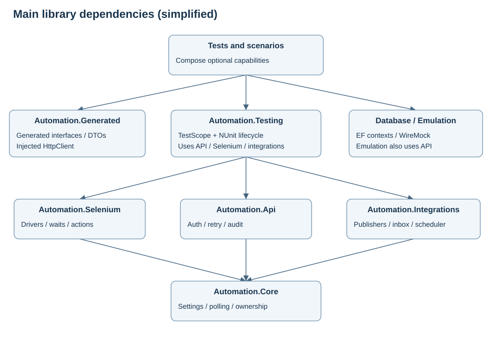
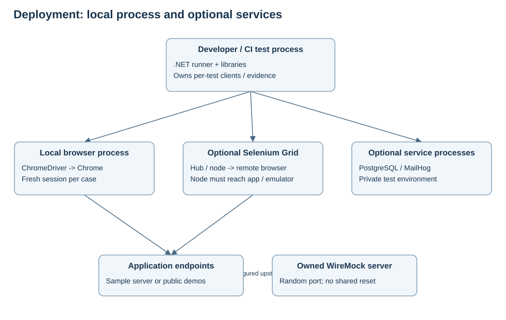

# High-level design

## Goals and quality attributes

The platform supports UI journeys, generated API setup/verification, eventual database assertions, controlled upstream failures and useful failure evidence. A selector change should stay in a page adapter; changing an inbox provider should not affect calendar navigation.

| Quality | Mechanism | Tradeoff |
|---|---|---|
| Isolation | One scope per case, fresh browser, random-port emulators, separate artifacts | Browser startup cost; external data still needs unique ownership |
| Determinism | Condition waits, seeded choices, explicit expected dates, bounded navigation | Real networks and public websites remain variable |
| Maintainability | Cohesive projects and small adapter contracts | More projects than a single test assembly |
| Observability | JSON events/results, screenshot and HTML on failure | Private application artifacts need appropriate retention/access |
| Extensibility | Constructor injection and generated interfaces | Default composition root changes for some substitutions |
| Reproducibility | Versioned contracts, package locks, generated source | First restore and driver resolution may require network access |
| Controlled effects | No automatic write retries; local reporting; repository write gate | Transactions are separate from the repository write gate |

## Logical module view

Arrows show important dependency directions, not every transitive package. Tests may reference multiple capabilities directly. There are 17 projects after the calendar addition.

| Project | Responsibility | Main boundary |
|---|---|---|
| Automation.Core | Settings, deadlines, cleanup, test data, artifacts, latency | No Selenium, EF or NUnit |
| Automation.Api | HTTP pipeline, tokens, JSON requests | HttpClient/handlers and ITokenProvider |
| Automation.Generated | Generated interfaces, DTOs and clients | Injected HttpClient, no framework composition |
| Automation.Selenium | Drivers, waits, actions, downloads, Grid probe | IWebDriver, IBrowserFactory, IElementWait |
| Automation.Database | Contexts, repositories, eventual reads, transactions | EF context factory; read/write interfaces |
| Automation.Emulation | WireMock, request capture, admin settings/benchmarks | HTTP protocol and owned server |
| Automation.Integrations | Inbox, publishers, scheduler, Jira/Zephyr | Service-specific clients and contracts |
| Automation.Documents | PDF text extraction | IPdfTextExtractor |
| Automation.Testing | Scope composition and NUnit lifecycle | Per-test ownership |
| SampleApp | Disposable API/HTML/admin example | No automation-library dependencies |
| DatePickerScenarios | Four page adapters, calendar abstraction, 19 scenarios | Existing scope and Selenium waits |
| Automation.Tests | Framework checks and local UI examples | NUnit |
| Automation.Bdd | Reqnroll example and hooks | One scope per scenario |
| Automation.DatePickers | Parameterized calendar fixture | Shared scenario catalog |
| ApiGenerator | Development-time contract generation | Local service manifest |
| SmokeCheck | Standalone local framework checks | No test discovery required |
| DatePickerRunner | Local navigation checks and opt-in live tests | Shared cases, sequential execution |

## Deployment view

Locally, the test process starts ChromeDriver and Chrome through Selenium. With Grid, the node owns the browser and must reach the application and emulator. Localhost inside a container refers to that container. Enable managed downloads on a Grid node and retrieve them using Downloads.FetchRemote.

Default sample tests own their local sample server. Calendar tests use the four explicit URLs in SitePages.cs. SQLite is sufficient for local database examples; PostgreSQL, Grid and MailHog are optional. WireMock runs in-process on a random port. No production application, reporting account or scheduler is provisioned.

## Combining features in a business journey

This is an extension design for your new app, not a claim that SampleApp implements one complete browser/API/database system.

1. Load settings and create a TestScope.
2. Start an owned emulator. Configure the application's upstream endpoint through its supported test configuration.
3. Create an entity using a generated client constructed from scope.ApiHttp. Register deletion immediately after successful creation.
4. Use a page object for the user operation. Wait for a meaningful application state change.
5. Observe the result using the API, an eventual database read, or an emulator journal. Correlate by the entity ID from setup.
6. Verify a downloaded document or uniquely addressed email when relevant.
7. Capture failure evidence, compensate in reverse order, dispose drivers/clients and write the local result.

These steps are coordinated assertions, not a distributed transaction. Rolling back a test's DB transaction does not undo an API call or the application's separate transaction. Cleanup compensates only for resources the test owns. Cleanup failures remain visible.

## Configuration boundaries

Precedence is defaults, shared JSON, environment-specific JSON, local JSON, then AUTOMATION_ environment variables. Nested keys use double underscores, such as AUTOMATION_Browser__Headless. AUTOMATION_ENVIRONMENT defaults to local. NUnit loads from its output directory; DatePickerRunner loads from the current working directory.

Web/API base URLs are separate and end in a slash to preserve relative base paths. OAuth has its own endpoint. An API token does not sign in a browser and a browser session does not authenticate an API client; implement each session setup explicitly.

## Parallelism

Independent scopes support isolated execution, but concurrency belongs to the runner. Never share a driver, EF context, page object or TestData random instance between simultaneous tests. A synchronized cleanup stack does not make every scope service thread-safe.

Public calendar cases are sequential with fresh cookies and browser state per case. They are optional external checks. Private suites can be partitioned by category and available Grid capacity, using owned data and cleanup. No distributed scheduler, concurrent load engine or cross-machine browser pool is included.
