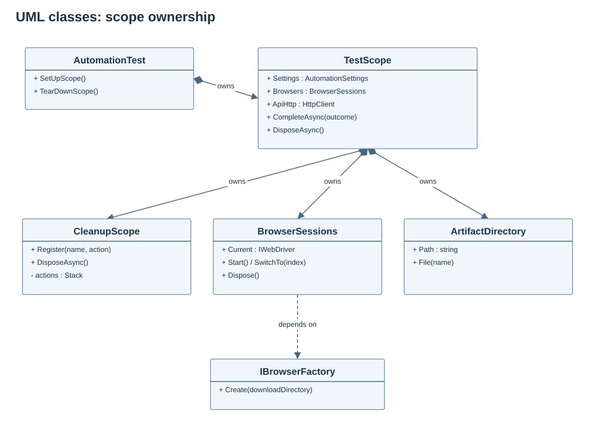
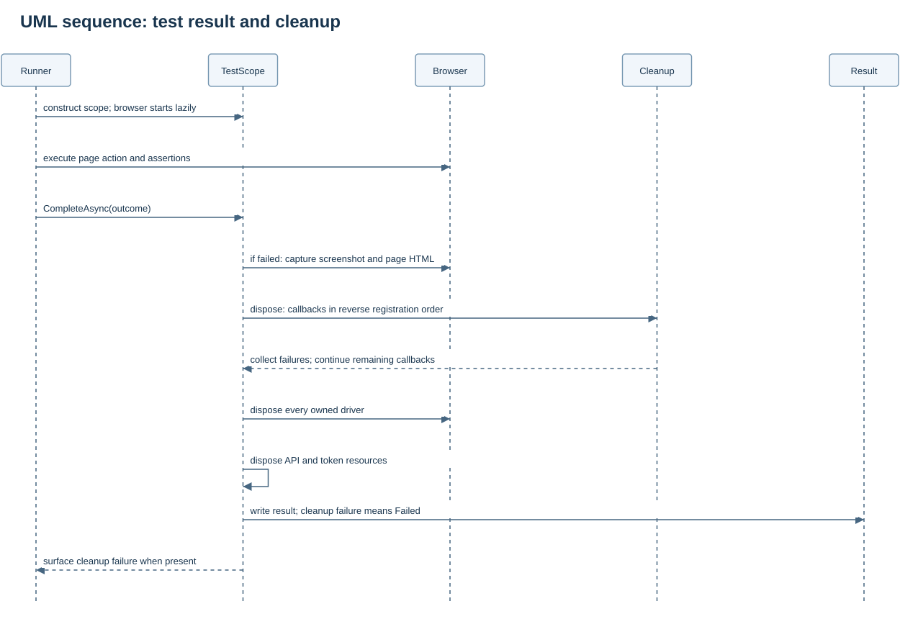
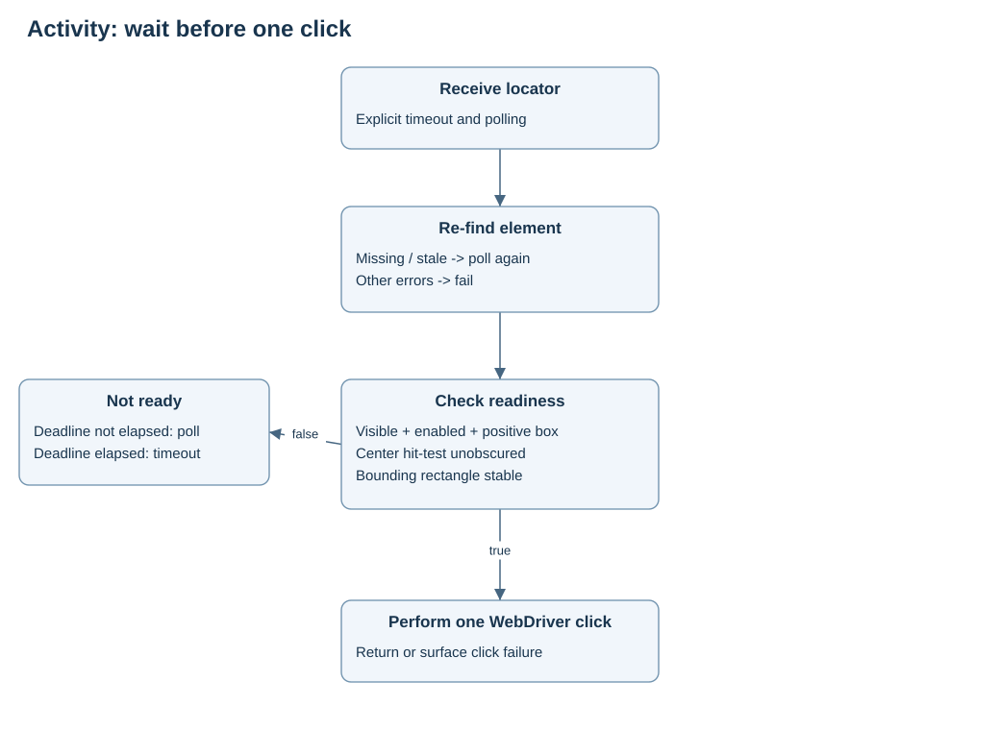
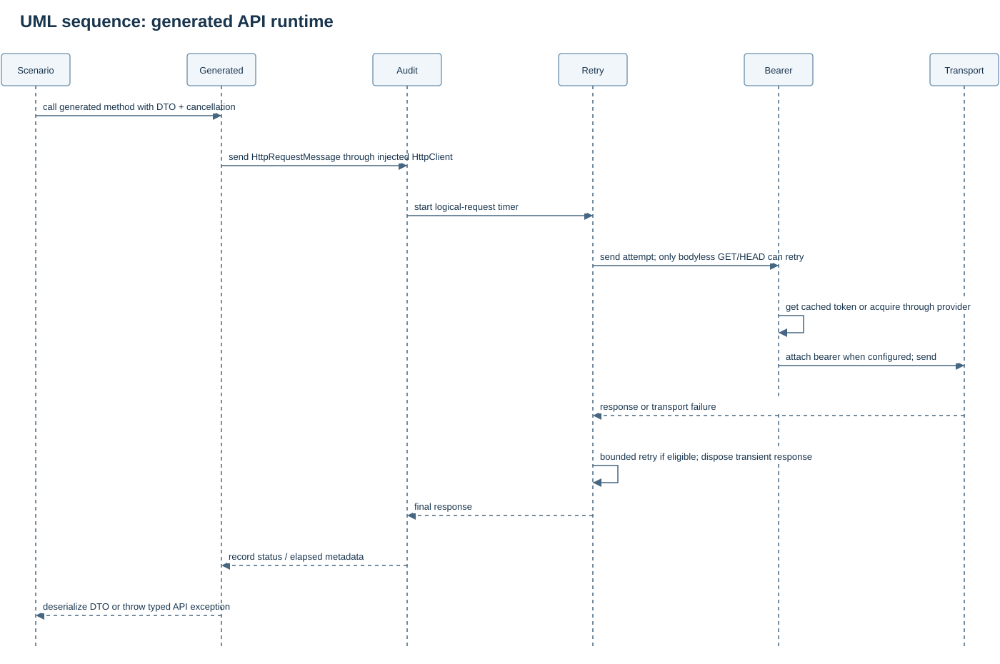
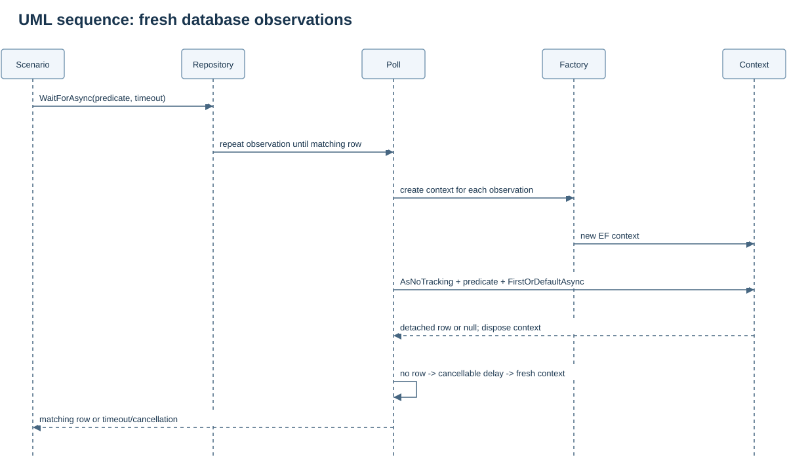
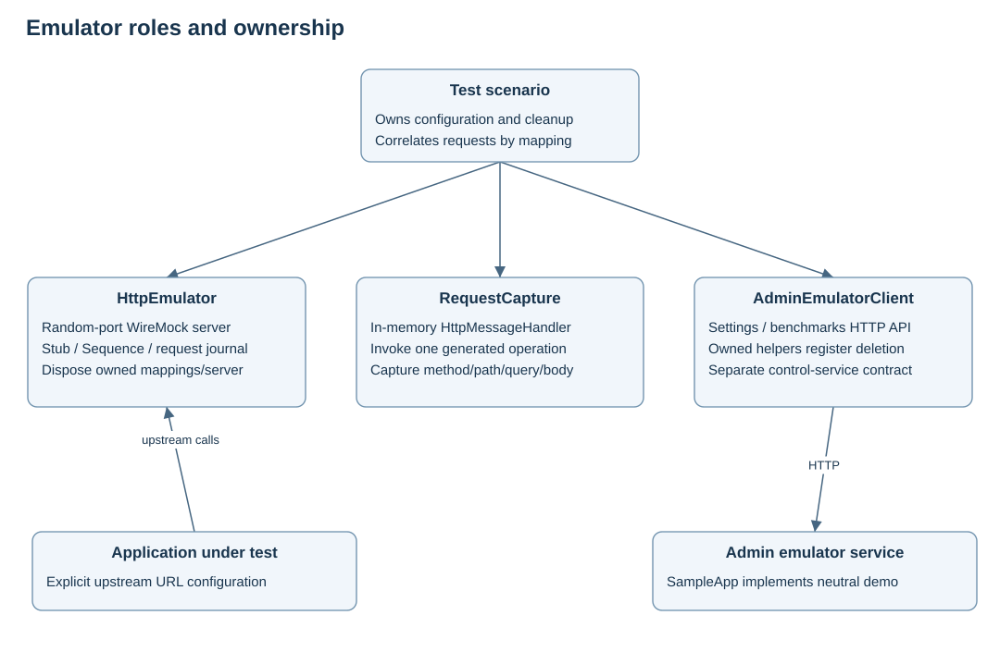

# Low-level design

The diagrams show implemented classes and ordering. Simplified UML omits some properties and generic constraints; source code is authoritative.

## Scope and lifecycle

AutomationTest creates TestScope during SetUp. InstancePerTestCase prevents fixture-field leakage. Reqnroll's ItemSteps creates its scope in BeforeScenario; the console runner constructs one directly. Scope creation validates settings, creates artifacts, records the data seed and composes HTTP/authentication. BrowserSessions is lazy: no browser starts until Current or Start is used.

CompleteAsync captures PNG/HTML on UI failure before disposal. Capture attempts are guarded individually. DisposeAsync attempts data cleanup and browser cleanup independently, disposes HTTP/token clients, and aggregates cleanup failures. Completion writes result.json, marking cleanup failure as Failed. NUnit attaches top-level files; DatePickerRunner also persists aggregate results after each case.

CleanupScope stores named asynchronous callbacks in a LIFO stack. Disposal snapshots work and memoizes the disposal task, so repeated disposal does not repeat compensation. Each callback has a 30-second deadline; a failed callback does not stop the others. Callbacks must honor cancellation: an uncooperative callback can continue after the wait times out. Total cleanup time can be the number of callbacks multiplied by their deadlines.

## Selenium readiness

BrowserFactory configures Chrome/Edge/Firefox or Grid, downloads, command/page-load timeouts and window size. Implicit wait is zero. BrowserSessions owns all drivers created within a test and attempts to dispose every driver, even after another close fails.

| Wait | Success | Limit |
|---|---|---|
| Present | Locator resolves | Does not imply visibility |
| Visible | Element is displayed | Does not imply unobscured |
| Clickable | Enabled, displayed, positive box, successful center hit-test, stable bounds | Scrolls into view and re-finds every poll |
| Click | Readiness followed by one WebDriver click | Never blindly replays a potentially successful action |
| Text / Enabled / Gone | Predicate / expected state / no displayed match | Choose an application-specific signal |
| StableList | Minimum count and stable text signature | Stable text does not prove identity or backend completion |
| DocumentReady / Url | Complete document / URI predicate | SPA hydration may still be pending |
| NetworkIdle | Installed fetch/XHR counter stays below threshold | Current document only; no prior requests, frame traffic, sockets or service workers |

Until creates an explicit WebDriverWait using configured timeout/polling. Only missing and stale element exceptions are ignored. Invalid selectors and other programming errors surface. Public calendar adapters wait on widget headers/values, not global network-idle on advertising-heavy pages.

DomMonthCalendar.MoveMonth computes the expected next month, clicks once and waits for that exact header. MonthNavigator rejects distances over 120 months before any click, verifies exactly one month per transition and checks a two-minute budget between steps. An in-progress WebDriver command can extend the wall-clock total. ClickDay requires the displayed target month. Date cells include a full-date identifier or a month/year-qualified locator.

## API generation and transport

ApiGenerator reads PascalCase service names and local specs from contracts/services.json. Names must be unique and resolved paths must stay inside contracts. All services are generated in memory before writing files: contract failures preserve previous generated files. Final multi-file writes are not an atomic filesystem transaction. Removing a service from the manifest does not delete its old generated file; remove obsolete files explicitly.

NSwag emits a namespace, interface, client and DTOs for each service. Clients accept HttpClient, use its base address and do not own disposal. The same client can call a real server, SampleApp, WireMock or an in-memory request-capture handler. Change contracts or add wrappers/partial extensions instead of editing .g.cs files.

The handler order is HttpAuditHandler -> ReadRetryHandler -> BearerHandler -> transport. Audit records the final logical outcome and elapsed time; it is outside retry and does not log every attempt. Bearer acquisition runs per attempt. Default redirects are disabled.

GET/HEAD without content may retry three times after the first attempt on transport failure or 408/429/500/502/503/504. Retried responses are disposed. Retry-After is clamped to 0..30 seconds; otherwise bounded exponential delay and jitter apply. HttpClient timeout is 60 seconds; cancellation propagates. POST/PUT/PATCH/DELETE are not automatically replayed.

ClientCredentialsTokenProvider serializes cache access/acquisition with SemaphoreSlim and refreshes ahead of expiry using a margin up to 60 seconds. OAuth requires HTTPS outside loopback. NoTokenProvider and StaticTokenProvider share ITokenProvider. Caches belong to the scope. There is no automatic 401 refresh-and-replay policy.

## Database

Repository implements distinct read/write interfaces and creates a disposable EF context per operation. Reads use AsNoTracking. WaitForAsync creates a fresh context every poll to avoid stale tracked values. Predicates are EF expressions; correlate by an owned resource ID.

Repository writes require its allowWrites constructor flag. This is a framework guard, not database authorization. DatabaseTransaction is separate and does not consult this flag. It uses the provider execution strategy, creates a context and transaction, invokes the delegate, saves, then rolls back by default or commits when explicitly requested. The delegate may be re-executed by the provider: keep HTTP/email side effects out of it.

ExampleDbContext maps SampleRecord to automation_records. Scaffold/design entities for your new schema. SQLite checks do not validate PostgreSQL-specific types, collation or transaction behavior. No production migration runs automatically.

## Emulators

HttpEmulator owns a random-port WireMock server. Stub returns a mapping ID; journal queries filter by mapping. Sequence uses unique scenario state and retains its last response. WaitForRequestsAsync checks a minimum count; use Requests with an exact-count assertion when duplicates matter. AssertNoRequestsAsync observes the entire requested window rather than checking one instantaneous empty journal.

RequestCapture invokes a generated operation with an in-memory transport and captures exactly one method/path/query/body. Supply a response compatible with that operation's return type. It rejects multiple sends. Captured body/query are not automatically used by Stub, which matches method/path only; add richer mappings for those contracts.

AdminEmulatorClient is a separate settings/benchmarks control adapter. Owned helpers register deletion after successful creation. Names must be unique: deleting a shared overwritten setting is not restoration. SampleApp implements this neutral contract but does not simulate original business transaction rules.

## Supporting capabilities

DataFlow executes named setup steps in sequence with the cleanup owner and cancellation. TestData records a seed for choices and uses GUIDs for unique names; the seed does not reproduce GUIDs. PerformanceProbe measures sequential latency, not concurrent load.

Downloads waits for the expected filename, no partial-file suffix, exclusive access and stable size. Grid downloads use Selenium's managed-download API. PDF text extraction is separate from browser mechanics; OCR is not supplied.

MailHog queries should use unique recipient/subject criteria. TestRail, Zephyr Enterprise and webhook publishers require explicit composition; default scope output is local JSON. Jira status and scheduler clients require your endpoint/contracts. These are supplied adapters, not automatically configured live integrations.
